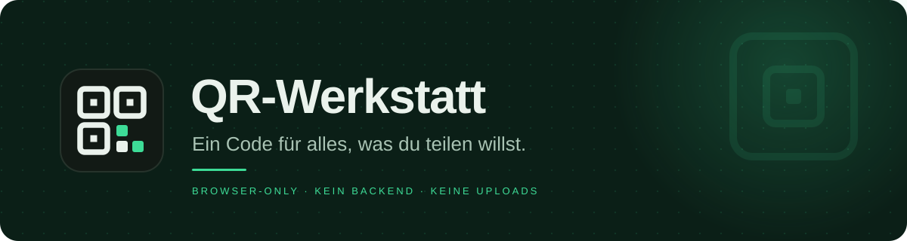
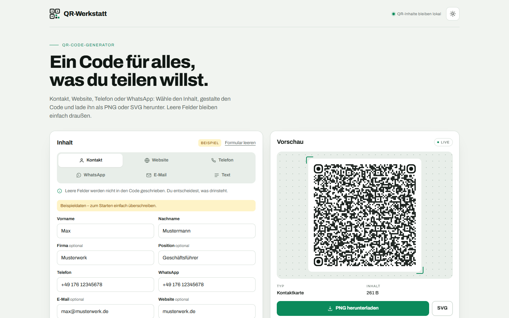
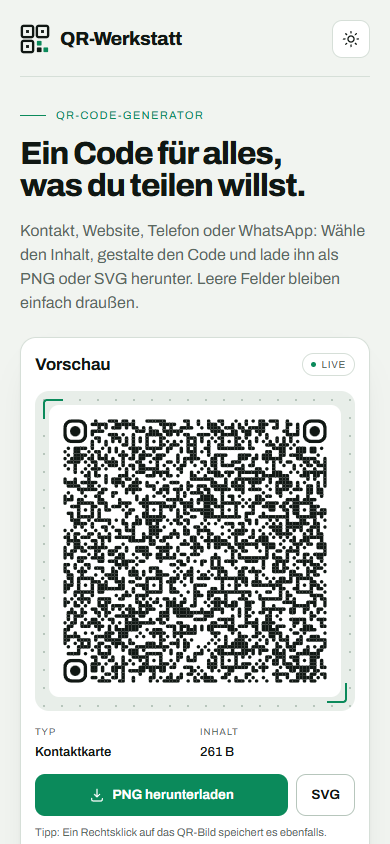

<p align="center">
  
</p>

<h1 align="center">QR-Werkstatt</h1>

<p align="center">
  <strong>Ein Code für alles, was du teilen willst.</strong><br>
  Kontakt, Website, Telefon, WhatsApp, E-Mail und freier Text – direkt im Browser,
  ohne Anmeldung und ohne Upload.
</p>

<p align="center">
  <a href="https://qr-werkstatt.pages.dev"></a>
  
  
</p>

<p align="center">
  
</p>

> **QR-Inhalte bleiben auf deinem Gerät.** Name, Logo, Website, Telefon, WhatsApp, E-Mail
> und Texte werden nur in deinem Browser verarbeitet. Es gibt kein Benutzerkonto und keine
> Formulardaten an einen Server.

<details>
<summary><strong>Inhalt</strong></summary>

- [Warum QR-Werkstatt?](#warum-qr-werkstatt)
- [Funktionen](#funktionen)
- [Schnellstart](#schnellstart)
- [Benutzung](#benutzung)
- [Inhaltstypen](#inhaltstypen)
- [Design](#design)
- [Datenschutz](#datenschutz)
- [Entwicklung](#entwicklung)
- [Prüfen](#prüfen)
- [Veröffentlichen](#veröffentlichen)
- [Beitragen](#beitragen)
- [Danksagung](#danksagung)

</details>

## Warum QR-Werkstatt?

QR-Codes sind schnell erstellt – aber selten schön, selten passend und oft mit einem
Umweg über einen fremden Server verbunden. QR-Werkstatt macht daraus ein kleines
Werkzeug: Inhalt wählen, gestalten, herunterladen. Alles im Browser, ohne Anmeldung,
ohne Upload.

Die Idee ist einfach: **Ein Code für alles, was du teilen willst.** Ob Kontaktkarte,
Website, Telefonnummer, WhatsApp-Chat, E-Mail oder freier Text – du entscheidest, was
im Code landet, und behältst die Gestaltung in der Hand.

## Funktionen

| Funktion | Details |
|---|---|
| **Sechs Inhaltstypen** | vCard, Website, Telefon, WhatsApp, E-Mail und freier Text |
| **Eine vCard für alles** | Name, Firma, Position, Telefon, E-Mail, Website und WhatsApp in einem Code |
| **Logo in der Mitte** | PNG, JPG, WebP oder SVG bis 2 MB; Größe von 20 bis 40 % einstellbar |
| **Design nach Geschmack** | Farben, Punkt- und Eckenstile, sechs Vorlagen, helles und dunkles Theme |
| **Sauberer Export** | PNG und SVG mit 1024 px, direkt im Browser erzeugt |
| **Scannbar bleiben** | Fehlerkorrektur Q ohne Logo, H mit Logo; Ruhezone mindestens vier Module; Kontrastwarnung |
| **Eine Schrift** | Archivo für die ganze Seite – lokal ausgeliefert, keine Google-Fonts-Anfrage |
| **Kein Backend** | Kein Konto, keine Datenbank, keine Formulardaten an einen Server |
| **Geprüft** | 37 automatisierte Prüfungen mit Playwright und jsQR, lokal und live |

## Schnellstart

Voraussetzungen: [Node.js](https://nodejs.org/) in der aktuellen LTS-Version und npm.
Es wird kein Server gestartet.

```bash
git clone https://github.com/Wortwurzel/qr-werkstatt.git
cd qr-werkstatt
npm ci
npm run check
npm run build
```

Danach `dist/index.html` im Browser öffnen.

> **Nur ausprobieren?** Die öffentliche Version läuft unter
> [qr-werkstatt.pages.dev](https://qr-werkstatt.pages.dev).

## Benutzung

1. **Inhalt wählen** – Kontakt, Website, Telefon, WhatsApp, E-Mail oder Text.
2. **Felder füllen** – leere Felder bleiben draußen; bei der vCard werden nur die
   Angaben übernommen, die du einträgst.
3. **Gestalten** – Logo, Farben, Punkt- und Eckenstil, Größe. Die Vorschau aktualisiert
   sich sofort.
4. **Herunterladen** – als PNG für Chat und Alltag oder als SVG für Druck und
   Weiterverarbeitung.

Die Vorschau warnt, wenn der Kontrast zu niedrig ist oder ein helles Muster auf dunklem
Grund schwer zu scannen ist.

> In einer eingebetteten Vorschau (Artifact) kann der Browser Downloads blockieren.
> Die veröffentlichte Seite lädt PNG und SVG normal herunter.

## Inhaltstypen

| Typ | Inhalt im QR-Code | Beispiel |
|---|---|---|
| **Kontakt** | vCard 3.0 mit Name, Firma, Position, Telefon, E-Mail, Website und WhatsApp | `BEGIN:VCARD …` |
| **Website** | vollständige URL; `https://` wird bei Bedarf ergänzt | `https://example.org` |
| **Telefon** | `tel:`-Link mit normalisierter Nummer | `tel:+4917612345678` |
| **WhatsApp** | `wa.me`-Link, optional mit vorausgefüllter Nachricht | `https://wa.me/4917612345678?text=Hallo` |
| **E-Mail** | `mailto:`-Link, optional mit Betreff | `mailto:hallo@example.org` |
| **Text** | freier Text bis 1.273 Byte | `Treffpunkt: 18:30` |

## Design

Die Gestaltung ist kein Zufall: QR-Codes müssen auch nach dem Styling zuverlässig
scannbar bleiben.

- **Fehlerkorrektur:** Q ohne Logo, H mit Logo. Je mehr Logo, desto mehr Redundanz.
- **Ruhezone:** mindestens vier Module ringsum, dynamisch aus der Modulzahl berechnet.
- **Kontrast:** Die Vorschau warnt bei zu wenig Kontrast oder hellem Muster auf dunklem Grund.
- **Eine Schrift:** Archivo trägt die ganze Seite – Überschrift, Formular, Labels und
  Zahlen. Keine zweite Schrift, keine Google-Fonts-Anfrage.
- **PNG und SVG:** PNG für Chat und Alltag, SVG für Druck und Weiterverarbeitung.
- **Beide Themes:** Die Seite folgt dem System und lässt sich hell oder dunkel umschalten.

<p align="center">
  
</p>

## Datenschutz

- **QR-Inhalte bleiben im Browser.** Name, Logo, Website, Telefon, WhatsApp, E-Mail und
  Texte werden nicht an einen Server geschickt.
- **Kein Konto, keine Formulare an einen Server.** Es gibt nichts zu speichern und
  nichts zu synchronisieren.
- **Lokale Speicherung:** Nur das Farbschema und Design-Einstellungen liegen im
  `localStorage`. QR-Inhalte und das Logo werden nicht gespeichert.
- **Besucherstatistik:** Die öffentliche Version zählt Seitenaufrufe mit Cloudflare Web
  Analytics – cookie-frei, ohne Nutzerprofile. Gezählt werden Besuche der Website, nicht
  Scans der erzeugten QR-Codes. Werbe- und Tracking-Blocker können die Zahl verkleinern.
- **Schriften lokal:** Archivo liegt im Repository und wird direkt von der Seite geladen;
  es gibt keine Anfrage an Google Fonts.

Die vollständige Datenschutzerklärung steht in der Fußzeile der Seite. Ein Impressum ist
nicht nötig, weil die Seite privat und nicht gewerblich ist.

## Entwicklung

Die gebaute Seite ist eine einzige statische HTML-Datei mit CSS und JavaScript. Die App
braucht keinen Bundler; `build.mjs` verpackt die Quelle und kopiert Bibliothek und Schrift.

| Datei | Zweck |
|---|---|
| `src/app.html` | Einzige Quelle: Layout, Stil, Logik und Datenschutz-Dialog |
| `build.mjs` | Baut `dist/index.html`, kopiert die Bibliothek und die Schrift |
| `vendor/qr-code-styling.js` | `qr-code-styling@1.9.2`, vendort und nicht bearbeitet |
| `vendor/fonts/` | Archivo als lokale WOFF2-Datei; Quelle und Prüfsumme in `SOURCE.md` |
| `check.mjs` | Ende-zu-Ende-Prüfung mit Playwright und jsQR |
| `AGENTS.md` | Projektregeln für Menschen und Agenten |
| `DEPLOY.md` | Cloudflare Pages und Besucherstatistik |
| `PLAN.md` / `PROGRESS.md` | Plan, Entscheidungen und Arbeitsstand |

Die Quelle ist ein Artifact-Fragment (ohne `<!doctype>`, `<html>`, `<head>` oder `<body>`);
`build.mjs` ergänzt doctype, head und Meta. `dist/` wird nie von Hand bearbeitet.

Wichtige Regeln:

- `src/app.html` ist die einzige Quelle. Nach Änderungen `npm run build` ausführen.
- Eine Schrift: Archivo. Keine zweite Schrift, keine externen Fonts.
- QR-Inhalte verlassen den Browser nicht; keine Formulardaten an einen Server.
- `localStorage` nur für Theme und Design, nie für Formularinhalte.
- Die Seite muss bei 390 px Breite ohne horizontales Scrollen funktionieren.
- `qr-code-styling` kodiert jedes Zeichen mit `charCodeAt & 0xFF`. Nicht-ASCII-Inhalte
  laufen deshalb durch `encodeQrData()`, das der Bibliothek die UTF-8-Bytes als
  Latin-1-Zeichenkette übergibt. Diese Funktion bleibt.
- vCard-Ausgabe nutzt CRLF, vCard-Escaping und bytegenaue 75-Oktett-Faltung. Das bleibt.
- Die Ruhezone bleibt bei mindestens vier Modulen; `quietZoneMargin()` berechnet sie.

## Prüfen

```bash
npm ci
npm run check
```

Erwartet: `CHECK OK: 37 Prüfungen`. Der Check öffnet die Seite in Playwright, füllt jeden
Inhaltstyp aus, rastert den erzeugten QR-Code und dekodiert ihn mit jsQR. Er prüft
außerdem Downloads, Logo, Themes, die lokale Schrift, die Datenschutz-Angaben und die
Darstellung bei 390 px. Das vollständige Protokoll steht in `check.log`.

Die veröffentlichte Seite prüfen:

```powershell
$env:CHECK_TARGET = "https://qr-werkstatt.pages.dev"; npm run check
```

Gegen eine absichtlich kaputte Kopie muss der Check mit Exit 1 enden:
`CHECK_TARGET=<pfad> node check.mjs`.

## Veröffentlichen

Die Seite läuft auf **Cloudflare Pages** und wird per Direct Upload veröffentlicht. Die
Schritte stehen in [`DEPLOY.md`](DEPLOY.md). Die Besucherstatistik läuft über Cloudflare
Web Analytics; der Beacon wird beim Deploy automatisch eingebaut. Die eigene Adresse
`qr.drwortwurzel.com` ist im Pages-Projekt eingetragen und wird per CNAME verbunden.

## Beitragen

Issues und Pull Requests sind willkommen. Bitte vor einem PR:

1. `npm ci`
2. `npm run check`
3. Die Seite bei 390 px Breite und in beiden Themes ansehen.

Kleine, klare Änderungen sind leichter zu prüfen als große Umbauten. Die Regeln aus
[`AGENTS.md`](AGENTS.md) gelten auch für Beiträge.

## Danksagung

- [qr-code-styling](https://github.com/kozakdenys/qr-code-styling) von Denys Kozak –
  die QR-Engine mit Logo, Formen und Export.
- [Archivo](https://fonts.google.com/specimen/Archivo) – die eine Schrift der Seite.
- [jsQR](https://github.com/cozmo/jsQR) und [Playwright](https://playwright.dev/) –
  die Werkzeuge hinter den automatisierten Prüfungen.

<p align="center"><sub>QR-Werkstatt · Ein Code für alles, was du teilen willst.</sub></p>
