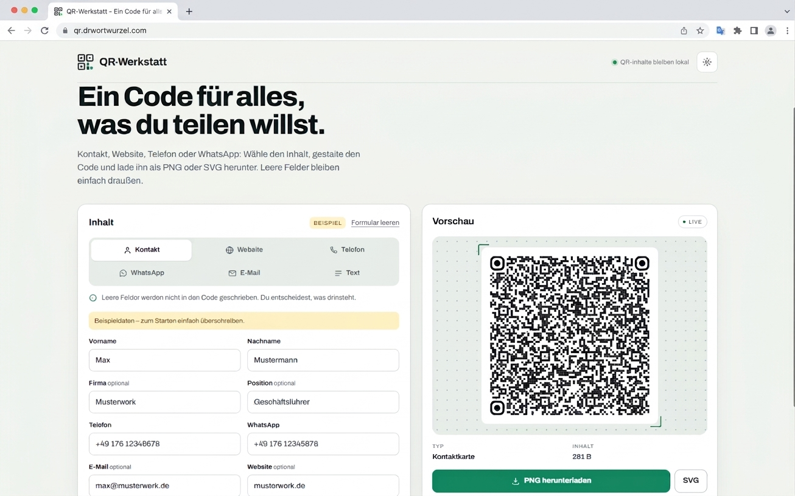
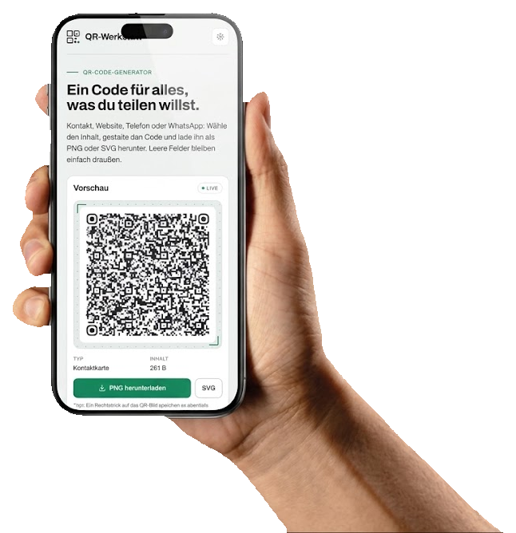

<p align="center">
  
</p>

<h1 align="center">QR-Werkstatt</h1>

<p align="center">
  <strong>One code for everything you want to share.</strong><br>
  Contact, website, phone, WhatsApp, email and free text – directly in the browser,
  no sign-up and no upload.
</p>

<p align="center">
  <a href="https://qr.drwortwurzel.com"></a>
  
  
</p>

<p align="center">
  
</p>

> **QR content stays on your device.** Name, logo, website, phone, WhatsApp, email and
> text are processed only in your browser. There is no user account and no form data is
> sent to a server.

<details>
<summary><strong>Contents</strong></summary>

- [Why QR-Werkstatt?](#why-qr-werkstatt)
- [Features](#features)
- [Quick start](#quick-start)
- [Usage](#usage)
- [Content types](#content-types)
- [Design](#design)
- [Privacy](#privacy)
- [Development](#development)
- [Checks](#checks)
- [Deployment](#deployment)
- [Contributing](#contributing)
- [Acknowledgments](#acknowledgments)

</details>

## Why QR-Werkstatt?

QR codes are quick to create – but rarely beautiful, rarely fitting, and often tied to a
detour through someone else's server. QR-Werkstatt turns that into a small tool: choose
the content, style it, download it. All in the browser, no sign-up, no upload.

The idea is simple: **One code for everything you want to share.** Whether it is a
contact card, a website, a phone number, a WhatsApp chat, an email or free text – you
decide what goes into the code, and you keep control over its design.

## Features

| Feature | Details |
|---|---|
| **Six content types** | vCard, website, phone, WhatsApp, email and free text |
| **One vCard for everything** | Name, company, job title, phone, email, website and WhatsApp in a single code |
| **Logo in the center** | PNG, JPG, WebP or SVG up to 2 MB; size adjustable from 20 to 40% |
| **Design to taste** | Colors, dot and corner styles, six presets, light and dark theme |
| **Clean export** | PNG and SVG at 1024 px, generated directly in the browser |
| **Stays scannable** | Error correction Q without a logo, H with a logo; quiet zone of at least four modules; contrast warning |
| **One typeface** | Archivo for the whole page – served locally, no Google Fonts request |
| **No backend** | No account, no database, no form data sent to a server |
| **Tested** | 37 automated checks with Playwright and jsQR, locally and live |

## Quick start

Requirements: [Node.js](https://nodejs.org/) in the current LTS version and npm.
No server is started.

```bash
git clone https://github.com/Wortwurzel/qr-werkstatt.git
cd qr-werkstatt
npm ci
npm run check
npm run build
```

Then open `dist/index.html` in your browser.

> **Just want to try it?** The public version runs at
> [qr.drwortwurzel.com](https://qr.drwortwurzel.com). The Cloudflare address
> `qr-werkstatt.pages.dev` remains available as a fallback.

## Usage

1. **Choose the content** – contact, website, phone, WhatsApp, email or text.
2. **Fill in the fields** – empty fields are left out; for the vCard, only the details
   you enter are included.
3. **Style it** – logo, colors, dot and corner style, size. The preview updates
   immediately.
4. **Download** – as PNG for chats and everyday use, or as SVG for print and further
   processing.

The preview warns when the contrast is too low or when a light pattern on a dark
background is hard to scan.

> In an embedded preview (Artifact), the browser may block downloads. The published site
> downloads PNG and SVG normally.

## Content types

| Type | Content in the QR code | Example |
|---|---|---|
| **Contact** | vCard 3.0 with name, company, job title, phone, email, website and WhatsApp | `BEGIN:VCARD …` |
| **Website** | full URL; `https://` is added when needed | `https://example.org` |
| **Phone** | `tel:` link with a normalized number | `tel:+4917612345678` |
| **WhatsApp** | `wa.me` link, optionally with a pre-filled message | `https://wa.me/4917612345678?text=Hello` |
| **Email** | `mailto:` link, optionally with a subject | `mailto:hello@example.org` |
| **Text** | free text up to 1,273 bytes | `Meeting point: 18:30` |

## Design

The design is not arbitrary: QR codes must remain reliably scannable even after styling.

- **Error correction:** Q without a logo, H with a logo. The more logo, the more redundancy.
- **Quiet zone:** at least four modules on all sides, calculated dynamically from the module count.
- **Contrast:** The preview warns about too little contrast or a light pattern on a dark background.
- **One typeface:** Archivo carries the whole page – heading, form, labels and numbers.
  No second typeface, no Google Fonts request.
- **PNG and SVG:** PNG for chats and everyday use, SVG for print and further processing.
- **Both themes:** The page follows the system setting and can be switched between light and dark.

<p align="center">
  <a href="docs/assets/screenshot-mobile-phone.png">
    
  </a>
</p>

## Privacy

- **QR content stays in the browser.** Name, logo, website, phone, WhatsApp, email and
  text are not sent to a server.
- **No account, no forms sent to a server.** There is nothing to save and nothing to
  synchronize.
- **Local storage:** Only the color scheme and design settings are stored in
  `localStorage`. QR content and the logo are not saved.
- **Visitor analytics:** The public version counts page views with Cloudflare Web
  Analytics – cookie-free, without user profiles. It counts visits to the website, not
  scans of the generated QR codes. Ad and tracking blockers can reduce the number.
- **Local fonts:** Archivo is part of the repository and is loaded directly by the page;
  there is no request to Google Fonts.

The full privacy notice is in the page footer. An Impressum is not required because the
site is private and non-commercial.

## Development

The built page is a single static HTML file with CSS and JavaScript. The app needs no
bundler; `build.mjs` wraps the source and copies the library and the font.

| File | Purpose |
|---|---|
| `src/app.html` | Single source: layout, style, logic and privacy dialog |
| `build.mjs` | Builds `dist/index.html`, copies the library and the font |
| `vendor/qr-code-styling.js` | `qr-code-styling@1.9.2`, vendored and not edited |
| `vendor/fonts/` | Archivo as a local WOFF2 file; source and checksum in `SOURCE.md` |
| `check.mjs` | End-to-end checks with Playwright and jsQR |
| `AGENTS.md` | Project rules for humans and agents |
| `DEPLOY.md` | Cloudflare Pages and visitor analytics |
| `PLAN.md` / `PROGRESS.md` | Plan, decisions and current state |

The source is an Artifact fragment (without `<!doctype>`, `<html>`, `<head>` or `<body>`);
`build.mjs` adds the doctype, head and meta tags. `dist/` is never edited by hand.

Important rules:

- `src/app.html` is the only source. Run `npm run build` after changes.
- One typeface: Archivo. No second typeface, no external fonts.
- QR content does not leave the browser; no form data is sent to a server.
- `localStorage` is only for theme and design, never for form content.
- The page must work at 390 px width without horizontal scrolling.
- `qr-code-styling` encodes each character with `charCodeAt & 0xFF`. Non-ASCII content
  therefore goes through `encodeQrData()`, which hands the library the UTF-8 bytes as a
  Latin-1 string. That function stays.
- vCard output uses CRLF, vCard escaping and byte-accurate 75-octet folding. That stays.
- The quiet zone stays at least four modules; `quietZoneMargin()` calculates it.

## Checks

```bash
npm ci
npm run check
```

Expected: `CHECK OK: 37 Prüfungen`. The check opens the page in Playwright, fills in every
content type, rasterizes the generated QR code and decodes it with jsQR. It also checks
downloads, the logo, themes, the local font, the privacy details and the layout at 390 px.
The full log is in `check.log`.

Check the published page:

```powershell
$env:CHECK_TARGET = "https://qr.drwortwurzel.com"; npm run check
```

Against a deliberately broken copy, the check must exit with 1:
`CHECK_TARGET=<path> node check.mjs`.

## Deployment

The page runs on **Cloudflare Pages** and is published via Direct Upload. The steps are in
[`DEPLOY.md`](DEPLOY.md). The main address is
[`qr.drwortwurzel.com`](https://qr.drwortwurzel.com); `qr-werkstatt.pages.dev` remains as a
fallback. Visitor analytics runs through a dedicated Cloudflare Web Analytics site for the
custom domain. The beacon is added at build time from `CF_WEB_ANALYTICS_TOKEN` in `.env`;
the file is gitignored. `npm run check` deliberately builds without the beacon so the
local test does not see CORS errors from `file://` – so run `npm run build` before
uploading.

## Contributing

Issues and pull requests are welcome. Please do the following before a PR:

1. `npm ci`
2. `npm run check`
3. Look at the page at 390 px width and in both themes.

Small, clear changes are easier to review than large rewrites. The rules in
[`AGENTS.md`](AGENTS.md) also apply to contributions.

## Acknowledgments

- [qr-code-styling](https://github.com/kozakdenys/qr-code-styling) by Denys Kozak –
  the QR engine with logo, shapes and export.
- [Archivo](https://fonts.google.com/specimen/Archivo) – the page's one typeface.
- [jsQR](https://github.com/cozmo/jsQR) and [Playwright](https://playwright.dev/) –
  the tools behind the automated checks.

And a huge special thanks to my wife for supporting me during the hard work I put into
this project. ❤️

## License

QR Code ist eine eingetragene Marke von DENSO WAVE INCORPORATED.

<p align="center"><sub>QR-Werkstatt · One code for everything you want to share.</sub></p>
